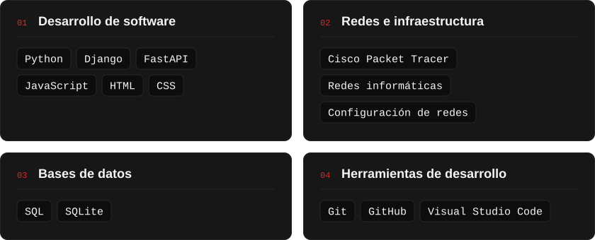
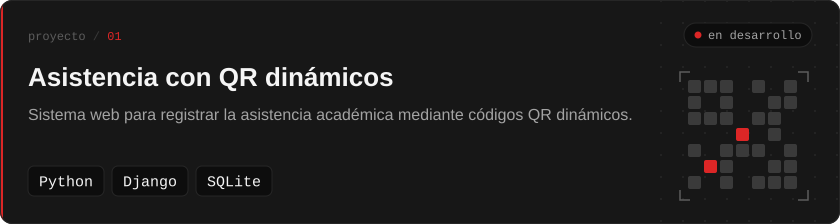
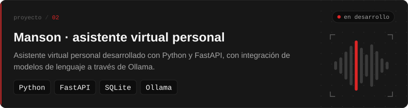
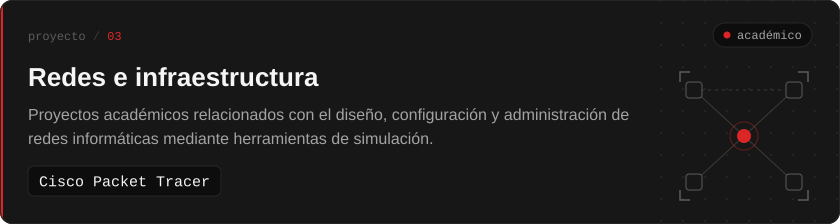

<!--
  ARCHIVO GENERADO — no lo edites a mano.
  Edita la sección «CONTENIDO» de scripts/generate_assets.py y ejecuta:
      python scripts/generate_assets.py
-->

  <picture>
    <source media="(max-width: 600px)" srcset="https://raw.githubusercontent.com/KarenLGT/KarenLGT/main/assets/banners/header-mobile.svg">
    
  </picture>

  <picture>
    <source media="(max-width: 600px)" srcset="https://raw.githubusercontent.com/KarenLGT/KarenLGT/main/assets/animations/terminal-mobile.svg">
    
  </picture>

### `01` &nbsp;Sobre mí

Soy **técnica en Sistemas** y **tecnóloga en Análisis y Desarrollo de Sistemas de Información (ADSI)**, y actualmente estudio **Ingeniería de Sistemas**.

Mi experiencia laboral se centra en el soporte técnico: mantenimiento de computadores, instalación y configuración de software, consultas SQL y resolución de incidencias relacionadas con sistemas de información.

Me interesan especialmente el desarrollo de software, las redes y la infraestructura tecnológica, áreas en las que trabajo a través de proyectos académicos y personales.

### `02` &nbsp;Tecnologías

  <picture>
    <source media="(max-width: 600px)" srcset="https://raw.githubusercontent.com/KarenLGT/KarenLGT/main/assets/banners/stack-mobile.svg">
    
  </picture>

Ver como texto

| Categoría | Herramientas |
|---|---|
| Desarrollo de software | Python · Django · FastAPI · JavaScript · HTML · CSS |
| Redes e infraestructura | Cisco Packet Tracer · Redes informáticas · Configuración de redes |
| Bases de datos | SQL · SQLite |
| Herramientas de desarrollo | Git · GitHub · Visual Studio Code |

### `03` &nbsp;Proyectos destacados

  <picture>
    <source media="(max-width: 600px)" srcset="https://raw.githubusercontent.com/KarenLGT/KarenLGT/main/assets/cards/project-qr-mobile.svg">
    
  </picture>

  <picture>
    <source media="(max-width: 600px)" srcset="https://raw.githubusercontent.com/KarenLGT/KarenLGT/main/assets/cards/project-manson-mobile.svg">
    
  </picture>

  <picture>
    <source media="(max-width: 600px)" srcset="https://raw.githubusercontent.com/KarenLGT/KarenLGT/main/assets/cards/project-networks-mobile.svg">
    
  </picture>

### `04` &nbsp;Contacto

Puedes seguir mi trabajo y contactarme a través de GitHub: **[@KarenLGT](https://github.com/KarenLGT)**.
